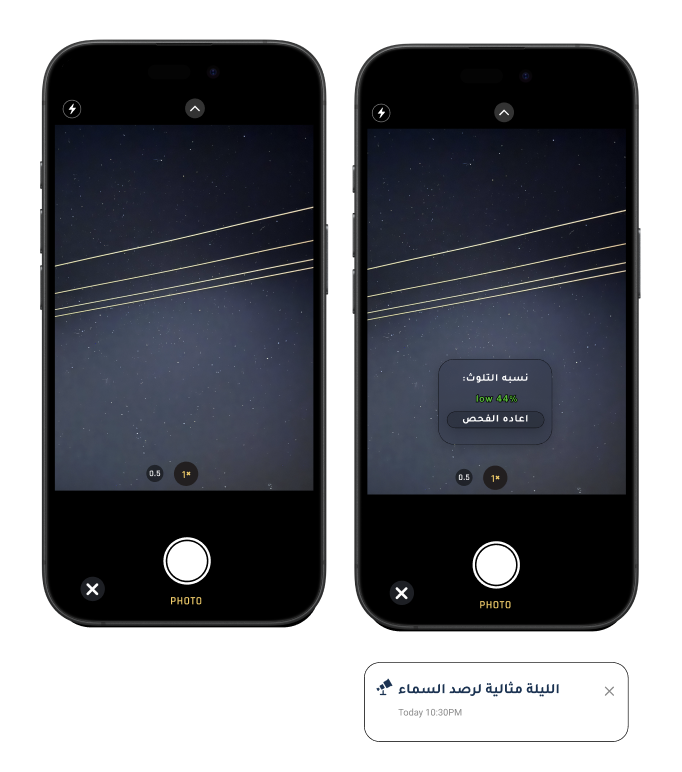
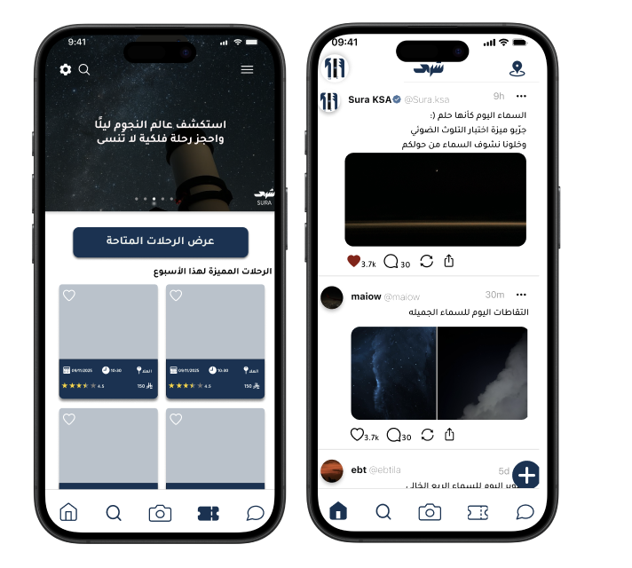
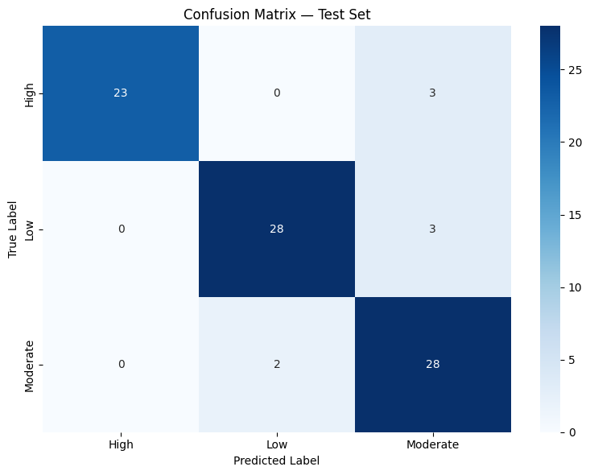
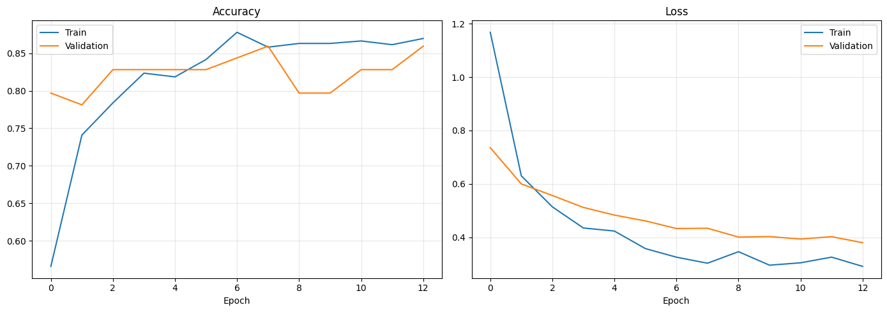
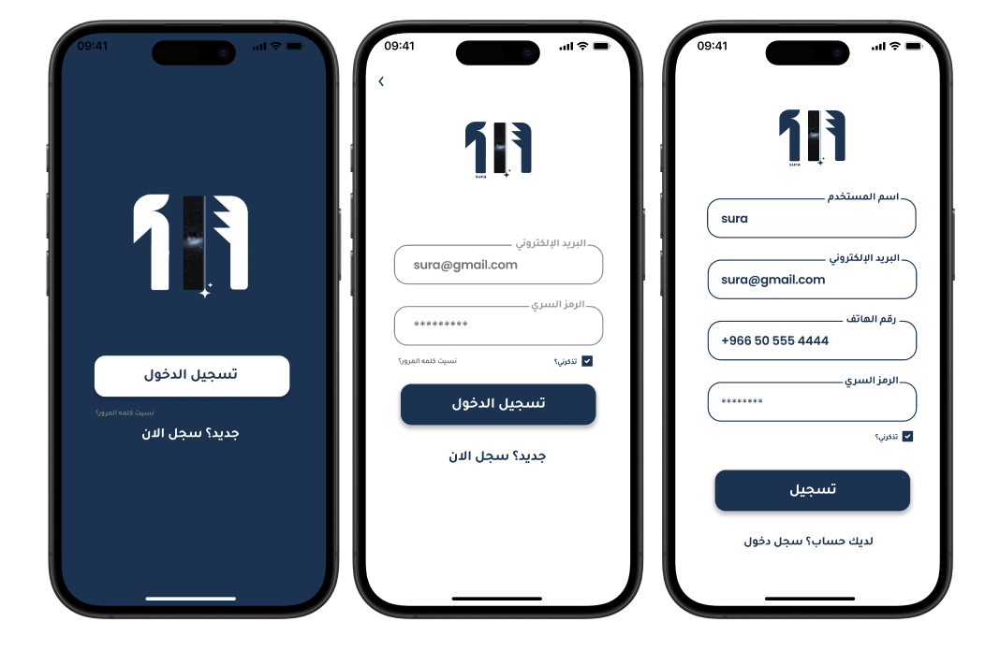
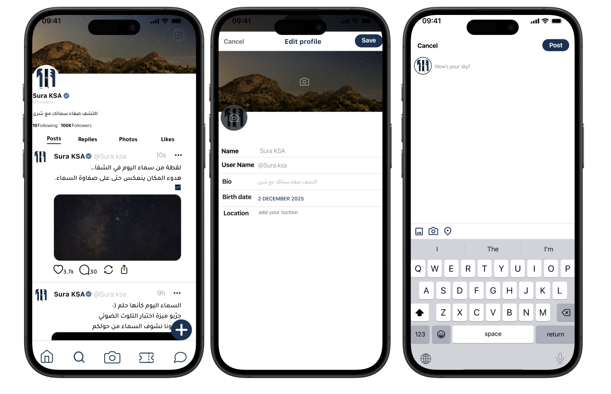

# SURA (سُرى): Light Pollution Classification App

**🏆 1st Place, Graduation Project Defense, Department of Computer Science, Jazan University (2026)**

A bilingual (Arabic/English) Flutter mobile app that lets users photograph the night sky and get an instant estimate of its light-pollution level. The estimate comes from an on-device EfficientNetB0 model trained on a custom dataset of 757 night-sky images labeled by the Bortle scale.

<p align="center">
  
  
</p>

## The problem

Light pollution hides the night sky for most people living in cities, and it is hard for a regular user to judge how dark the sky is at a given place. No open dataset provided night-sky photos labeled by the Bortle scale, so we built one and trained a model that turns a phone photo into a clear answer.

## How it works

1. The user takes or uploads a photo of the night sky.
2. A TensorFlow Lite model **running on the phone** (no server needed) classifies it into one of three levels:

| Class | Bortle scale | What the sky looks like |
|---|---|---|
| Low | 1–3 | Milky Way clearly visible, many stars, no artificial glow |
| Moderate | 4–6 | Milky Way washed out, faint light dome on the horizon |
| High | 7–9 | Few stars, strong orange/white glow |

3. Predictions below **60% confidence** are rejected instead of shown as a guess.
4. The app shows a sky quality score (0–100), the Bortle class, a brightness histogram, and a verdict on whether the sky is good for stargazing.

## Dataset

A custom dataset of **757 night-sky images**, collected mainly from open-access sources (Wikimedia Commons, NASA Image Library, ESO, Globe at Night) and labeled manually.

| Class | Images | Share |
|---|---|---|
| High | 200 | 26.4% |
| Low | 273 | 36.1% |
| Moderate | 284 | 37.5% |

- **Labeling rules:** the sky must be the main subject; then judge sky brightness and color, Milky Way visibility and star count, and horizon glow.
- **Quality filtering:** removed twilight shots, images under 400×400 px, corrupted images, and images that were ambiguous between two classes.
- **Format cleanup:** converted HEIC/WebP/AVIF images to JPEG.

## Model

| Setting | Value |
|---|---|
| Base model | EfficientNetB0, pre-trained on ImageNet (frozen) |
| Head | Global average pooling → batch norm → dropout (0.4) → softmax (3 classes) |
| Split | 606 train / 64 validation / 87 test |
| Augmentation | Horizontal flip, rotation, brightness, contrast |
| Class imbalance | Inverse-frequency class weights (High = 1.26) |
| Training | Adam (lr = 1e-3), early stopping on validation accuracy |
| Export | TensorFlow Lite with dynamic-range quantization (4.3 MB) |

## Results

**Test accuracy: 90.80%** (79 of 87 unseen test images classified correctly)

| Class | Precision | Recall | F1-score |
|---|---|---|---|
| High | 1.00 | 0.88 | 0.94 |
| Low | 0.93 | 0.90 | 0.92 |
| Moderate | 0.82 | 0.93 | 0.88 |



**What the errors show:** all 8 mistakes involve the **Moderate** class. The model never confused Low with High. This matches the hardest part of labeling, because the boundary between neighboring Bortle levels (for example, 6 and 7) is hard to see in a photo.



The full training and evaluation code is in [`ml_training/SuraApp_Training.ipynb`](ml_training/SuraApp_Training.ipynb).

## Limitations

- Labels were assigned by a single annotator, and the Bortle scale is partly subjective.
- Camera settings (ISO, exposure time) change how bright a sky looks, and they were not controlled.
- The test set is small (87 images), so the accuracy figure has a wide margin of uncertainty.
- High-pollution sky photos were the hardest to find, because astrophotographers avoid light-polluted places.

## App features

- **Sky analysis:** classify a sky photo with the on-device model
- **Light pollution map:** explore pollution levels and dark-sky sites
- **Stargazing conditions:** weather, cloud cover, moon phase, twilight times and visible planets
- **Community:** share sky photos, comment, follow users and send messages
- **Trips:** create and join stargazing trips
- **Cosmic events:** notifications for upcoming astronomy events
- **Arabic and English**, with light and dark themes

<p align="center">
  
  
</p>

## Tech stack

| Area | Tools |
|---|---|
| Machine learning | Python, TensorFlow / Keras, scikit-learn, TensorFlow Lite, Google Colab |
| Mobile app | Flutter (Dart), Riverpod, go_router, flutter_map |
| Backend | Firebase Authentication, Cloud Firestore, Firebase Storage |

## My role

This was a six-member team project. My main contributions were:

- **Dataset:** collecting and labeling the night-sky images by Bortle scale
- **Model evaluation:** analyzing results with the classification report and confusion matrix
- **Firebase:** contributing to the Authentication and Firestore integration and the data structure for user data

## Repository structure

```
├── light_pollution_app/      Flutter app
│   ├── lib/features/         App screens (analysis, map, community, trips, chat, ...)
│   ├── lib/core/             Shared services, theme and models
│   └── assets/               TFLite model, logo and data files
├── ml_training/
│   ├── SuraApp_Training.ipynb  Final model training and evaluation
│   └── scripts/                Earlier data collection scripts
├── docs/                     Charts and app screenshots
└── SURA_Design_Spec.md       UI/UX design specification
```

## Running the app

```bash
cd light_pollution_app
flutter pub get
flutter run
```

Requires the Flutter SDK and a connected device or emulator.

## Team

Ebtihaj Abdulrahman Akkur · Shahad Mohammed Ogdi · May Ali Moafa · Wanas Ghaleb Zaidan · Shahad Mohammed Hadadi · Afaf Bandar Al Qasmi

**Supervisor:** Dr. Muath Al-Hussain Ibrahim Khawaji
